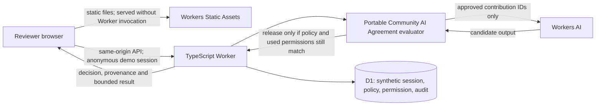

# System overview

## Deployed prototype architecture

The static user interface is not an authority boundary. The Worker adapts its session policy, researcher role and individual permissions into the portable agreement, then uses its deterministic evaluator before inference. It sends only approved contribution IDs to Workers AI. At the output-release boundary it atomically rechecks the active policy configuration/version, researcher session and exact versions of every used permission; if authorization changed during inference, it persists no output and records a withholding event. A denied request ends before inference. Only `/api/*` routes invoke the Worker; other requests are served from the asset manifest and SPA fallback. Production inference and visible output were verified before the current governance updates; those updates still require deployment and a new live check. Local tests use a deterministic mock explicitly enabled for development. A separate, undeployed Worker example consumes the same agreement evaluator.

## Trust boundaries

- The browser is public and untrusted. Client-side validation helps usability only.
- A visitor session isolates fictional records; it is not verified identity or a real representative credential.
- The API and its D1 binding are the enforcement boundary for this prototype.
- Workers AI receives only a small fixed synthetic input and can fail or be unavailable.
- Cloudflare controls infrastructure and model execution. The demo does not prove removal from model weights or eliminate provider trust.
- GitHub Actions builds and checks source; deployment credentials, if later needed, must be scoped to the new project and kept out of source.

## State and records

Implemented records: short-lived demo session (two hours; 500 new sessions/day), community, proposal and effective policy versions, each synthetic contribution's purpose-scoped permission and versioned history, fixed research requests, per-contribution authorization and exclusion evidence, AI execution provenance, append-oriented audit events, and a benefit obligation with fictional community agreement, research-team acceptance, evidence and community-review states. The portable agreement exposes this policy, model restrictions and benefit state as JSON. Permission history records the state, version, action, actor, timestamp and correlation ID; a session permits up to 50 versions. Existing sessions receive a baseline snapshot during migration; pre-migration permission transitions cannot be reconstructed. API requests are capped at 60 per minute per session and AI attempts at 100 per day. Do not store free-form health narratives.

Reset and expiry delete the synthetic session and its permission history through the database's cascading foreign key. This is a temporary reviewer record, not a durable community consent ledger.

## Failure behavior

Missing, expired, conflicting or unreadable authorization facts fail closed. D1 or AI service errors return a clear retryable error without claiming completion. Only successful calls are marked executed. Audit records are ordinary database evidence and can be altered by an operator with sufficient access; integrity fields are not tamper-proof guarantees.
