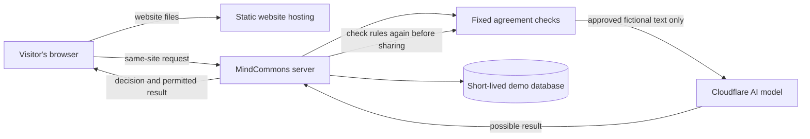

# How the demo is put together

This page describes the live prototype in plain language. The picture shows where each part runs and which information it handles.

## What happens when someone tries a research task

The browser displays the controls, but it does not decide whether a request is allowed. The server reads the current fictional community rule, each relevant person's permission, the requested purpose, the allowed model and task, and any required benefit terms. Fixed software checks these facts before the model is called.

If the request passes, the server sends only the selected synthetic text to the AI model. Before it saves or returns the result, it checks whether the policy, permissions, or required benefit facts changed while the model was working. If they changed, the service withholds the result. The model provider may already have received and processed the text; withholding cannot undo that.

The policy preview helps visitors understand a decision and does not call AI. Submitting a research task is a separate action. A local test model is a mock: a test substitute that does not make an AI call. The separate Worker example is tested locally and is not deployed.

## What each part does

- **Browser:** shows the public demo and sends requests. It is public and cannot be trusted to enforce the rules.
- **MindCommons server (Cloudflare Worker):** applies the checks and controls calls to the model.
- **D1 database:** stores fictional demo records for a short time. A session expires after two hours; reset removes its records. Expiry does not promise that every infrastructure copy is physically erased at exactly that time.
- **Workers AI:** processes selected synthetic text for an approved fixed task. It is an outside service.
- **Static website hosting:** serves public website files. Only API requests run the server code.

## Records and limits

A demo session can contain a fictional community rule, versioned permissions for fictional contributors, a fixed research request, an authorization decision, an AI run record, and benefit steps. Permission history is capped at 50 changes per session. Requests are limited to 60 per minute per session, new sessions to 500 per day, and AI attempts to 100 per day. These limits reduce abuse but do not guarantee that shared account allowances are available.

The demo does not accept free-form health stories, uploaded scripts, or arbitrary prompts. Missing, expired, conflicting or unreadable permission facts cause a denial. Database records and event history are not tamper-proof: an operator with sufficient access could change them.
