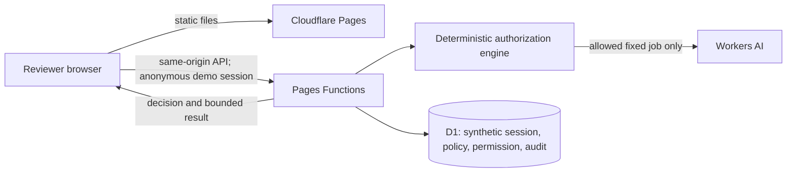

# System overview

## Intended MVP architecture (not deployed yet)

The static user interface is not an authority boundary. The function loads server-owned demo facts, applies role, policy, permission, purpose, job and expiry checks, writes decision evidence, and calls Workers AI only for an allowed operation. A denied request ends before inference.

## Trust boundaries

- The browser is public and untrusted. Client-side validation helps usability only.
- A visitor session isolates fictional records; it is not verified identity or a real representative credential.
- The API and its D1 binding are the enforcement boundary for this prototype.
- Workers AI receives only a small fixed synthetic input and can fail or be unavailable.
- Cloudflare controls infrastructure and model execution. The demo does not prove removal from model weights or eliminate provider trust.
- GitHub Actions builds and checks source; deployment credentials, if later needed, must be scoped to the new project and kept out of source.

## State and records

Expected records: short-lived demo session, community, policy proposal and effective version, fictional individual permission with purpose/expiry/withdrawal state, fixed research request, authorization decision, AI execution provenance, append-oriented audit event, and hypothetical benefit commitment. Do not store free-form health narratives.

## Failure behavior

Missing, expired, conflicting or unreadable authorization facts fail closed. D1 or AI service errors return a clear retryable error without claiming completion. Only successful calls are marked executed. Audit records are ordinary database evidence and can be altered by an operator with sufficient access; integrity fields are not tamper-proof guarantees.
