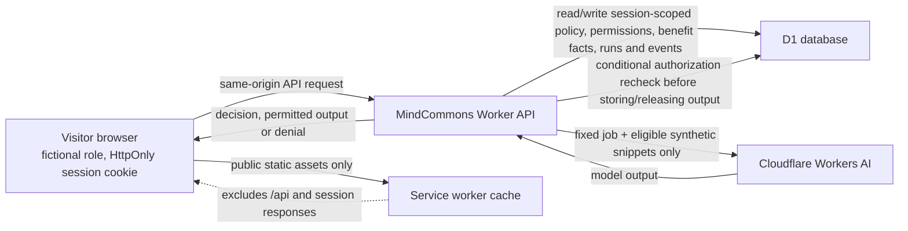

# Threat model

## Assets

Prototype policy versions, fictional permission records, authorization results, AI-call budget, synthetic outputs, session isolation and truthful public claims. No real health information is an allowed asset.

## Adversaries and risks

- Anonymous visitor alters requests, claims a role, replays or floods endpoints, probes other sessions, or submits oversized input.
- A researcher requests an unapproved purpose, model or job type.
- A bug or missing database fact allows a denied operation to reach AI.
- Logs, browser storage or service-worker caches retain data unexpectedly.
- A cloud provider or privileged operator can access or change hosted records.
- A reviewer mistakes fictional roles, mock tests, or an ordinary audit table for real governance or immutable evidence.
- Resource exhaustion causes quota failure or unexpected paid activation.

## Implemented controls and verification status

- Server-controlled opaque session, two-hour expiry and isolation; at most 500 new synthetic sessions per UTC day. In this public synthetic scenario, visitors can switch among fictional seats through the API. The server stores the selected seat in that visitor's session and checks it for each action, but does not authenticate a real person's identity or authority. This demonstrates policy enforcement logic, not production identity or governance security.
- Strict schemas, fixed job IDs/model IDs, and no script upload or arbitrary prompt execution. JSON bodies are read incrementally, and the stream is canceled as soon as the configured byte limit is exceeded, even when the request omits or understates `Content-Length`.
- Fail-closed authorization before AI; separate policy, individual permission and explicitly required benefit checks; negative tests spy on AI binding.
- Same-origin mutation checks, no cross-origin credential support, security headers, safe text rendering, no secrets in browser.
- Application-level rate limits (60 requests/minute/session), a 500-session/day cap and a 100-call/day AI cap; local API tests exercise each cap. No automatic upgrade or paid fallback.
- Do not log submitted narratives; synthetic-only corpus; no API caching or browser persistence of sensitive records.
- Append-oriented decision events with correlation IDs, without claiming tamper resistance.
- Session-scoped decision receipt export validates a structured snapshot and omits cookies, session identifiers, raw narratives and model output. Foreign-session run IDs return 404. Receipts are ordinary D1 records, not signed, immutable, independently certified or legally conclusive.
- Locked dependencies, CI least privilege, secret scanning, build and browser tests.

## Data flow and trust boundaries

The browser cannot upload records or prompts for this fixed job. The Worker selects text from the checked-in fictional corpus only after server-side authorization. On the hosted path, eligible synthetic snippets cross the Worker boundary to Cloudflare Workers AI; this is an external provider boundary. The model response returns to the Worker, which checks the same policy version, used permission versions, session role and any required benefit facts before persisting/releasing the result. A denied request does not call AI. A withheld result means the model call already happened; it does not recall the submitted text or undo provider processing.

The service worker caches the public shell and selected static assets. It bypasses `/api/` requests and does not store session state, permissions, research results or model output. API responses use `Cache-Control: no-store`. The frontend does not write session or research data to localStorage, sessionStorage or IndexedDB. The session cookie is HttpOnly, SameSite=Lax and Secure on HTTPS; its opaque identifier is not authentication of a real person.

Session access expires after two hours. Explicit reset deletes that session and its child records immediately. Expired sessions become inaccessible and are deleted on a request that discovers expiry or by opportunistic cleanup when a new session is created (cleanup is throttled to once an hour). This is not a fixed two-hour physical deletion guarantee. Cloud provider operational logs and model-provider retention are outside this prototype's deletion control.

The D1 conditional update is a narrow release guard against app-visible changes between authorization and output persistence. It is not a distributed transaction with the model provider. A change after output has already been returned cannot retract that output; a provider may already have processed the synthetic input; privileged provider/operator access is outside the guarantee.

## Residual risks and scope

Public demos remain vulnerable to denial of service and service outages. Free-plan limits are account-level and may be shared with other projects. Demo roles are intentionally switchable and must never be treated as verified researcher or community-representative identity. Production use needs independently designed authentication, authorization, representative selection, objection, appeal, stop and safeguarding processes. This prototype has no verified real identity, community authority, clinical controls, independent security audit, or patient-data suitability. A live provider executes model inference outside the community's infrastructure. A governance record cannot technically force deletion from copied datasets or model weights.
