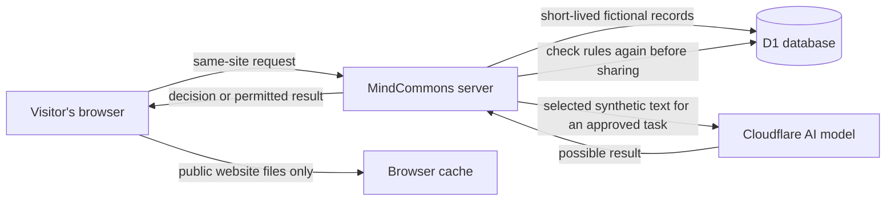

# Security: what could go wrong and what protects the demo

A threat model is a list of important information, possible attacks and the protections in place. This one covers the public synthetic demo only. No real health information is accepted.

## What needs protection

The project protects the demo's fictional permissions and rules, decisions about whether a task may run, the limited AI-call allowance, results, and separation between visitors' sessions. It also needs to avoid misleading visitors about what has or has not been proven.

## Possible problems

A visitor could change a request, pretend to be another demo role, send too many requests, try to read another session's records, or send an oversized request. Someone could ask for a forbidden purpose or model. A software error or missing database fact could accidentally allow a denied task. Information could be kept in logs or browser storage. A reviewer could mistake fictional roles or test results for real authority or live AI. Shared service limits could be exhausted.

## Protections in the prototype

- Each visitor gets a short-lived, separate session. The demo allows switching among fictional seats within that session; it does not verify real identity or authority.
- Requests have a fixed structure, a fixed task and a fixed model. Visitors cannot upload scripts or arbitrary research text.
- The server checks the community rule, individual permissions and required benefits before calling AI. If facts are missing or disagree, it denies the task.
- Automated tests check that denied requests do not call the AI function.
- Requests must come from the same website. Security settings and safe text handling reduce common browser risks.
- The demo limits requests to 60 per minute per session, new sessions to 500 per day, and AI attempts to 100 per day. These limits do not guarantee shared Cloudflare capacity.
- The app does not log free-form narratives, store research results in browser storage or cache API responses.
- Decision receipts are limited to the current session and do not include cookies, raw narratives or model output. They are regular database records, not signed or tamper-proof proof.
- Dependencies, code style, tests, browser behavior and secrets are checked in the repository's automated workflow.

## Where information goes

The browser can only use the fixed fictional corpus. If an approved task runs, selected synthetic text crosses the boundary to Cloudflare Workers AI. If permission changes after that, the app can withhold the result, but it cannot undo the provider's earlier receipt or processing.

The website cache does not store API requests or session data. A protected cookie reconnects the browser to its temporary session. The session expires after two hours; reset removes its linked database rows. Cleanup of expired rows is not guaranteed at the exact expiry time. Cloud provider records are outside this app's deletion controls.

## What remains outside the protection

A public demo can still be unavailable, overwhelmed or affected by a provider outage. Service quotas are shared across the account. The fictional role switcher is not real identity verification. The agreement cannot control a service that ignores it, copies of information outside a participating service, or results already released.

Before real research, a project would need a separate identity and authority design, community-approved processes, appropriate ethics and legal review, privacy and security assessment, safeguards, incident response and a reviewed model-provider arrangement. The current prototype is not suitable for patient information and has not had an independent security audit.
